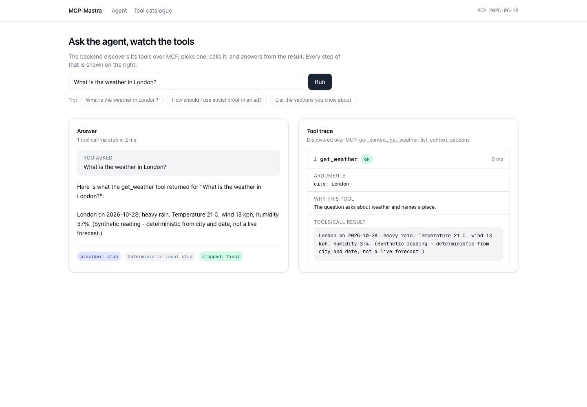

# MCP-Mastra

A small Model Context Protocol server, an agent loop that calls it, and a Next.js console that shows the answer next to the list of tool calls the agent made.



By default the agent uses a local stub provider (a keyword rule table), so it runs without an API key or network access. Setting `MODEL_PROVIDER=openai` switches to a Mastra agent on an OpenAI model.

## What's in it

- MCP server with `initialize`, `ping`, `tools/list` and `tools/call`, served over HTTP (`POST /mcp`) and stdio
- Three tools: `get_context`, `list_context_sections` and `get_weather` (synthetic, deterministic readings, not a real forecast)
- Agent loop that talks to the server through an MCP client, validates tool arguments with Zod and stops after `MAX_TOOL_STEPS` or the overall `AGENT_TIMEOUT_MS` deadline (30 seconds by default)
- Web console with the agent chat and a tool catalogue page for sending raw `tools/call` requests

Backend: Node, TypeScript, Express, Zod, `@mastra/core`. Frontend: Next.js 15, React 19, Tailwind.

## Running locally

Two terminals:

```bash
cd Backend
cp .env.example .env   # optional, all values have defaults
npm install
npm run dev            # API on http://localhost:7271
```

```bash
cd Frontend
npm install
npm run dev            # console on http://localhost:7272
```

Quick checks:

```bash
curl -s http://localhost:7271/healthz
curl -s -X POST http://localhost:7271/mcp \
  -H 'Content-Type: application/json' \
  -d '{"jsonrpc":"2.0","id":1,"method":"tools/list"}'
```

To run the server as a stdio MCP subprocess instead: `cd Backend && npm run mcp:stdio`.

### Using OpenAI

In `Backend/.env`:

```
MODEL_PROVIDER=openai
OPENAI_API_KEY=sk-...
OPENAI_MODEL=gpt-4o-mini
```

If the key is missing the server logs a warning and falls back to the stub.

## API

| Method | Path | Description |
|---|---|---|
| GET | `/healthz` | Provider, protocol version, tool names, config warnings |
| GET | `/api/tools` | Tool catalogue fetched through the MCP client |
| POST | `/api/chat` | `{ question }` in, answer plus `steps` out |
| POST | `/mcp` | Raw JSON-RPC |

## Tests

```bash
cd Backend && npm test
cd Frontend && npm test
```

Both packages also have `npm run lint` and `npm run typecheck`.

## Execution limits

The deadline covers tool discovery, model decisions and tool calls together, so a
provider that never resolves cannot hold an HTTP request open indefinitely. A timeout
returns 504. Closing the browser request aborts the run; cancellation reaches the hosted
SDK and HTTP MCP transport. Shared MCP initialization uses the transport's own timeout.
Third-party tools may already have performed side effects before cancellation, so a
timeout is not a transaction rollback.

The backend suite includes stalled discovery/model/tool fixtures, caller cancellation,
a 504 response, and a mocked SDK assertion that receives the abort signal. These checks
make no model calls and do not establish the quality or latency of the hosted model.

## Notes

- The stub provider routes weather questions to `get_weather` and most other things to `get_context`. It does not chain tools.
- The OpenAI path type-checks but hasn't been run against a real key.
- The MCP implementation covers tools only (no resources, prompts or sampling), and `/mcp` has no authentication.
