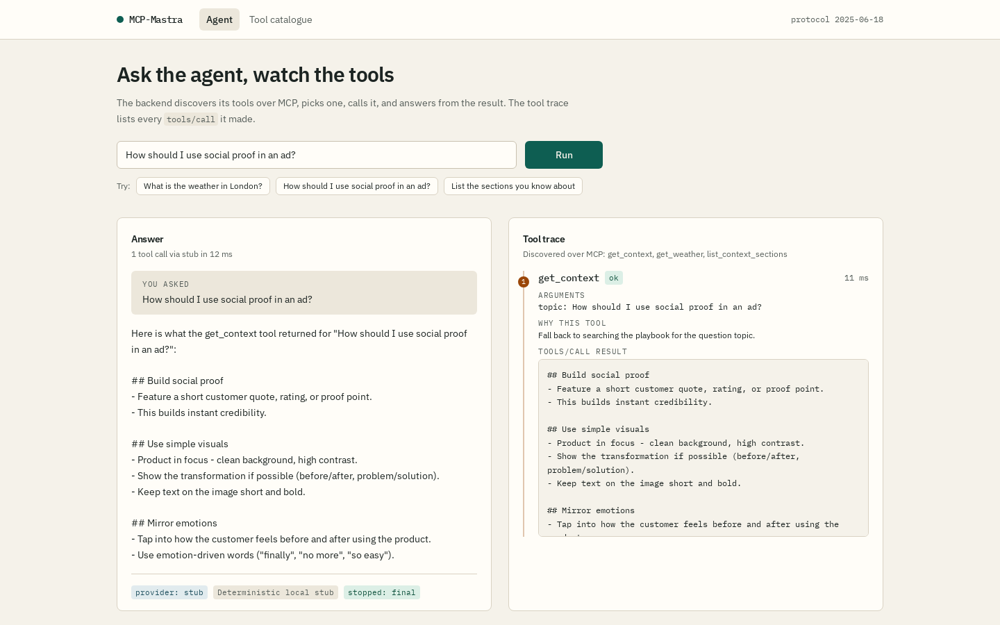
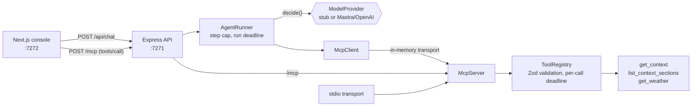
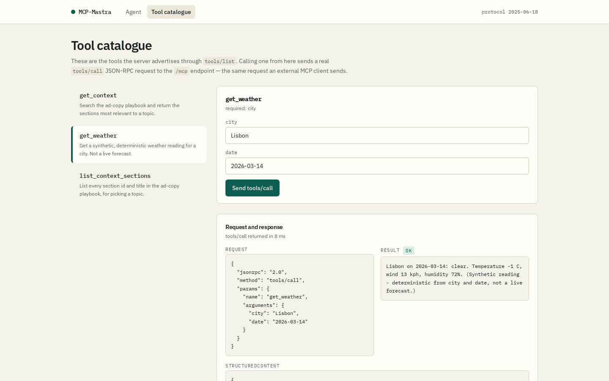
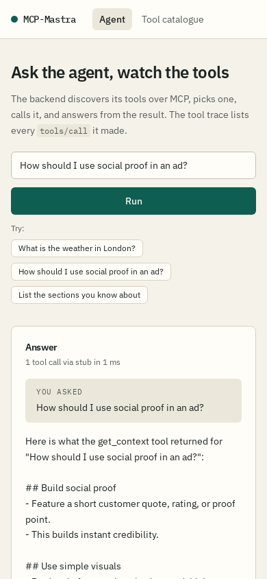

# MCP-Mastra

A small Model Context Protocol server, an agent loop that reaches its tools through an MCP client, and a Next.js console that shows the answer next to every tool call the agent made: which tool, with which arguments, why, and what came back.



The point is to make tool selection visible. When an agent picks the wrong tool or sends bad arguments, the trace shows it instead of leaving you to guess from the final answer.

By default the agent runs on a deterministic local stub (a keyword rule table), so the whole stack works with no API key and no network. Setting `MODEL_PROVIDER=openai` swaps in a Mastra agent on an OpenAI model behind the same interface.

## What's in it

- An MCP server with `initialize`, `ping`, `tools/list` and `tools/call`, served over HTTP (`POST /mcp`) and over stdio.
- Three tools: `get_context` and `list_context_sections` search a small ad-copy playbook; `get_weather` returns a synthetic reading derived from the city and date (deterministic, not a real forecast).
- An agent loop that discovers tools over MCP, validates arguments with Zod, stops after `MAX_TOOL_STEPS`, and has deadlines on each tool call and on the whole run.
- A web console with the agent chat and a tool catalogue page that sends raw `tools/call` requests to `/mcp`.

Backend: Node 22, TypeScript, Express 5, Zod, `@mastra/core`. Frontend: Next.js 15, React 19, Tailwind 4.

## Quick start

With Docker:

```bash
docker compose up --build
```

Then open http://localhost:7272. The API is on http://localhost:7271. Every setting has a default; to change one, copy `.env.example` to `.env` next to `docker-compose.yml` and edit it.

Without Docker (Node 22, see `.nvmrc`), in two terminals:

```bash
cd Backend
cp .env.example .env   # optional
npm install
npm run dev            # API on http://localhost:7271
```

```bash
cd Frontend
npm install
npm run dev            # console on http://localhost:7272
```

## How it fits together



The API holds one `McpServer` instance. The agent reaches it through the same `McpClient` an external consumer would use, over an in-memory transport, so the API has no back door into the tools. `/mcp` and the stdio entry point serve that same server to outside clients.

## API

| Method | Path | Description |
|---|---|---|
| GET | `/healthz` | Provider, protocol version, tool names, limits, config warnings |
| GET | `/api/tools` | Tool catalogue fetched through the MCP client |
| POST | `/api/chat` | `{ "question": "..." }` in, the answer and the step trace out |
| POST | `/mcp` | Raw JSON-RPC 2.0 |

These exchanges were captured from the Compose stack.

Ask the agent:

```bash
curl -s -X POST http://localhost:7271/api/chat \
  -H 'Content-Type: application/json' \
  -d '{"question":"What is the weather in Lisbon?"}'
```

```json
{
  "question": "What is the weather in Lisbon?",
  "answer": "Here is what the get_weather tool returned for \"What is the weather in Lisbon?\":\n\nLisbon on 2026-11-08: heavy rain. Temperature -3 C, wind 25 kph, humidity 87%. (Synthetic reading - deterministic from city and date, not a live forecast.)",
  "provider": "stub",
  "providerLabel": "Deterministic local stub",
  "toolsDiscovered": ["get_context", "get_weather", "list_context_sections"],
  "steps": [
    {
      "index": 0,
      "tool": "get_weather",
      "arguments": { "city": "Lisbon" },
      "rationale": "The question asks about weather and names a place.",
      "ok": true,
      "output": "Lisbon on 2026-11-08: heavy rain. Temperature -3 C, wind 25 kph, humidity 87%. (Synthetic reading - deterministic from city and date, not a live forecast.)",
      "structured": {
        "city": "Lisbon", "date": "2026-11-08", "condition": "heavy rain",
        "temperatureC": -3, "windKph": 25, "humidityPct": 87, "synthetic": true
      },
      "durationMs": 1
    }
  ],
  "stoppedBy": "final",
  "durationMs": 3
}
```

`stoppedBy` is `final` when the provider answered, `step_limit` when it hit `MAX_TOOL_STEPS`, `deadline` when the run went over `RUN_TIMEOUT_MS`, and `cancelled` when the client went away first.

Call a tool directly over JSON-RPC:

```bash
curl -s -X POST http://localhost:7271/mcp \
  -H 'Content-Type: application/json' \
  -d '{"jsonrpc":"2.0","id":2,"method":"tools/call","params":{"name":"get_weather","arguments":{"city":"Lisbon","date":"2026-03-14"}}}'
```

```json
{
  "jsonrpc": "2.0",
  "id": 2,
  "result": {
    "content": [
      {
        "type": "text",
        "text": "Lisbon on 2026-03-14: clear. Temperature -1 C, wind 13 kph, humidity 72%. (Synthetic reading - deterministic from city and date, not a live forecast.)"
      }
    ],
    "structuredContent": {
      "city": "Lisbon", "date": "2026-03-14", "condition": "clear",
      "temperatureC": -1, "windKph": 13, "humidityPct": 72, "synthetic": true
    }
  }
}
```

Bad arguments are a protocol error with the failing field named:

```json
{"jsonrpc":"2.0","id":3,"error":{"code":-32602,"message":"Invalid arguments for tool \"get_weather\"","data":[{"path":"city","message":"String must contain at least 1 character(s)"}]}}
```

A body that is not JSON gets HTTP 400 with a JSON-RPC parse error, `{"jsonrpc":"2.0","id":null,"error":{"code":-32700,"message":"Parse error"}}`, and a body over 64 kB gets 413.



## Running as a stdio MCP server

Desktop MCP clients launch servers as a subprocess and speak newline-delimited JSON over stdin/stdout. The same tools are available that way:

```bash
cd Backend && npm run mcp:stdio      # from source, via ts-node
node dist/stdio.js                   # after npm run build, or inside the backend image
```

```text
> {"jsonrpc":"2.0","id":1,"method":"initialize","params":{"protocolVersion":"2025-06-18"}}
< {"jsonrpc":"2.0","id":1,"result":{"protocolVersion":"2025-06-18","capabilities":{"tools":{"listChanged":false}},"serverInfo":{"name":"mcp-mastra-tools","version":"1.0.0"}}}
```

Diagnostics go to stderr, so nothing but protocol ever reaches stdout.

## Configuration

Backend variables (see `Backend/.env.example`; Compose passes the same names through from `.env`):

| Variable | Default | Meaning |
|---|---|---|
| `PORT`, `HOST` | `7271`, `0.0.0.0` | Where the API listens |
| `MODEL_PROVIDER` | `stub` | `stub` or `openai` |
| `OPENAI_API_KEY`, `OPENAI_MODEL` | unset, `gpt-4o-mini` | Only read when the provider is `openai` |
| `MAX_TOOL_STEPS` | `4` | Ceiling on tool calls per question |
| `TOOL_TIMEOUT_MS` | `5000` | Deadline for one `tools/call`, on every transport |
| `RUN_TIMEOUT_MS` | `60000` | Deadline for a whole `/api/chat` run, model calls included |
| `CORS_ORIGINS` | `*` | Comma-separated allow-list |

The frontend reads `NEXT_PUBLIC_API_BASE` (default `http://localhost:7271`). It is inlined at build time, so in Docker it is a build argument.

With `MODEL_PROVIDER=openai` and no key, the server logs a warning, reports it on `/healthz`, and falls back to the stub rather than failing.

## Design notes

- **One seam for models.** `ModelProvider` has a single `decide()` method: given the transcript and the discovered tools, call a tool or answer. The loop owns everything else (the step cap, the MCP calls, the trace, the deadlines), so the stub and the OpenAI provider behave identically from the console's point of view. The OpenAI provider asks the model for one JSON decision at a time instead of handing tool execution to the framework, which keeps the trace and the step cap in this project's hands.
- **Protocol errors and tool errors stay apart.** An unknown tool or invalid arguments raises a JSON-RPC error. A tool that throws, or runs past `TOOL_TIMEOUT_MS`, returns content with `isError: true`, which the agent reads as a result and can recover from.
- **Deadlines and cancellation.** Every tool handler gets an `AbortSignal` that fires at its deadline. The run has its own deadline, and `/api/chat` aborts the run when the client disconnects, so an abandoned request does not keep paying for model calls. The signal is passed to the model call, and the loop also stops waiting on its own.
- **The stub is the default, not a fallback.** It routes weather questions (matched as whole words) to `get_weather`, catalogue questions to `list_context_sections`, and everything else to `get_context`. That is enough to exercise discovery, validation, the trace and the UI with stable test assertions.
- **The weather tool is synthetic on purpose.** A reading hashed from city and date is varied and reproducible, so a test can tell whether the arguments arrived.
- **Lazy model imports.** `@mastra/core` and `@ai-sdk/openai` are imported only when the OpenAI provider makes its first call, so the default path never loads them.

## Tests and checks

```bash
cd Backend && npm test && npm run lint && npm run typecheck && npm run format:check
cd Frontend && npm test && npm run lint && npm run typecheck && npm run build
```

The backend has 110 Vitest tests covering the protocol, server, client, registry deadlines, tools, the stub, the loop (step cap, run deadline, cancellation) and the HTTP API, including a real client disconnect. The frontend has 14 tests for the API client and formatting helpers.



## Limitations

- The MCP surface covers tools only: no resources, prompts, sampling, or `notifications/cancelled` from the client side.
- `/mcp` has no authentication. Do not expose it beyond a trusted network.
- The OpenAI path type-checks and its JSON parsing is tested, but it has not been run against a real key. `@mastra/core` stays on 0.18 and `@ai-sdk/openai` on 1.x; moving to Mastra 1.x and AI SDK v5 is a migration that needs a key to verify.
- The stub answers with one tool call per question and does not chain tools.
- The tool catalogue page only renders inputs for string arguments; `get_context`'s numeric `limit` can be sent through `/mcp` directly.

## License

MIT, see [LICENSE](LICENSE).
